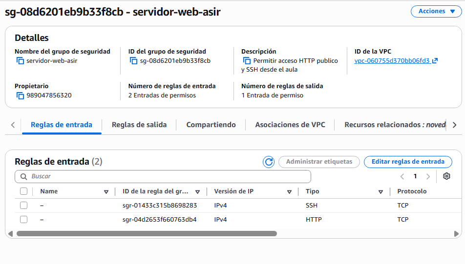
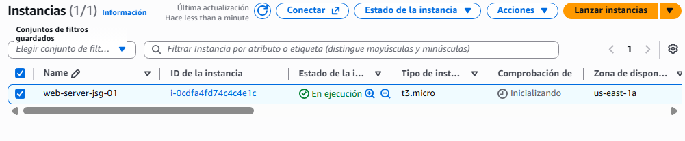
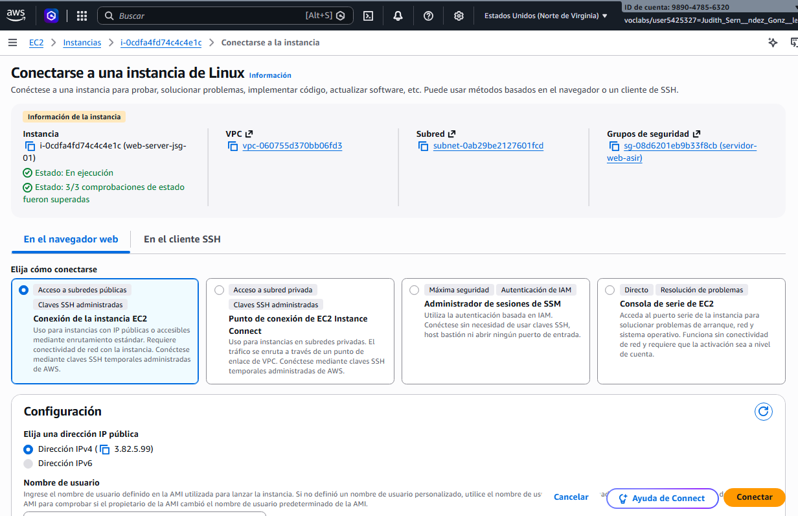
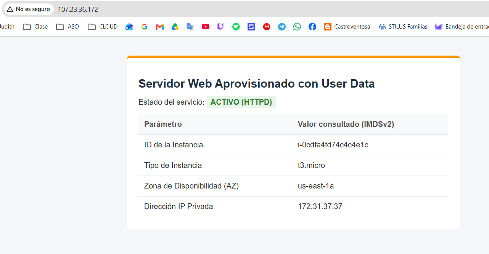
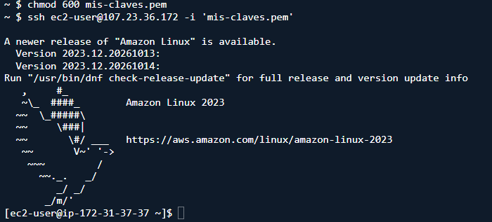

# PR0301: Despliegue automatizado de servidor web mediante User Data y metadatos IMDSv2

## Paso 1: Creación del Grupo de Seguridad (Security Group)

Antes de lanzar el cómputo, se deben definir las políticas de filtrado de tráfico.

En la consola de AWS, acceder a EC2 > Network & Security > Security Groups.
Pulsar en Create security group y rellenar los datos:
Security group name: sg-servidor-web-asir
Description: Permitir acceso HTTP publico y SSH desde el aula
VPC: Seleccionar la VPC por defecto del laboratorio.
Configurar las reglas de entrada (Inbound rules):

Dejar las reglas de salida (Outbound rules) por defecto (todo el tráfico permitido hacia 0.0.0.0/0) para que la máquina pueda descargar paquetes del repositorio oficial de AWS.
Guardar pulsando en Create security group.


Paso 2: Análisis del Script de User Data
El siguiente script se inyectará en la instancia durante el asistente de lanzamiento.

```python
#!/bin/bash
# -----------------------------------------------------------------
# 1. Actualización e instalación del servidor web Apache
# -----------------------------------------------------------------
dnf update -y
dnf install -y httpd

# Habilitar e iniciar el servicio en el arranque de systemd
systemctl enable httpd
systemctl start httpd

# -----------------------------------------------------------------
# 2. Obtención de metadatos mediante IMDSv2
# -----------------------------------------------------------------
# Paso A: Generar token de sesión válido por 6 horas (21600 segundos)
TOKEN=$(curl -s -X PUT "http://169.254.169.254/latest/api/token" \
  -H "X-aws-ec2-metadata-token-ttl-seconds: 21600")

# Paso B: Consultar metadatos usando el token en la cabecera HTTP
INSTANCE_ID=$(curl -s -H "X-aws-ec2-metadata-token: $TOKEN" \
  http://169.254.169.254/latest/meta-data/instance-id)

INSTANCE_TYPE=$(curl -s -H "X-aws-ec2-metadata-token: $TOKEN" \
  http://169.254.169.254/latest/meta-data/instance-type)

AVAILABILITY_ZONE=$(curl -s -H "X-aws-ec2-metadata-token: $TOKEN" \
  http://169.254.169.254/latest/meta-data/placement/availability-zone)

PRIVATE_IP=$(curl -s -H "X-aws-ec2-metadata-token: $TOKEN" \
  http://169.254.169.254/latest/meta-data/local-ipv4)

# -----------------------------------------------------------------
# 3. Creación del archivo index.html dinámico
# -----------------------------------------------------------------
cat <<EOF > /var/www/html/index.html
<!DOCTYPE html>
<html lang="es">
<head>
    <meta charset="UTF-8">
    <title>Servidor Web EC2 - ASIR Cloud</title>
    <style>
        body { font-family: 'Segoe UI', Tahoma, Geneva, Verdana, sans-serif; background-color: #f4f6f9; margin: 40px; color: #333; }
        .card { background: white; max-width: 650px; margin: 0 auto; padding: 25px; border-radius: 8px; box-shadow: 0 4px 6px rgba(0,0,0,0.1); border-top: 5px solid #FF9900; }
        h1 { color: #232F3E; font-size: 24px; margin-bottom: 20px; }
        table { width: 100%; border-collapse: collapse; margin-top: 15px; }
        th, td { text-align: left; padding: 12px; border-bottom: 1px solid #e1e4e8; }
        th { background-color: #f8f9fa; color: #555; }
        .badge { background: #e8f5e9; color: #2e7d32; padding: 4px 8px; border-radius: 4px; font-weight: bold; font-family: monospace; }
    </style>
</head>
<body>
    <div class="card">
        <h1>Servidor Web Aprovisionado con User Data</h1>
        <p>Estado del servicio: <span class="badge">ACTIVO (HTTPD)</span></p>
        <table>
            <tr><th>Parámetro</th><th>Valor consultado (IMDSv2)</th></tr>
            <tr><td><strong>ID de la Instancia</strong></td><td>$INSTANCE_ID</td></tr>
            <tr><td><strong>Tipo de Instancia</strong></td><td>$INSTANCE_TYPE</td></tr>
            <tr><td><strong>Zona de Disponibilidad (AZ)</strong></td><td>$AVAILABILITY_ZONE</td></tr>
            <tr><td><strong>Dirección IP Privada</strong></td><td>$PRIVATE_IP</td></tr>
        </table>
    </div>
</body>
</html>
EOF
```

## Paso 3: Lanzamiento de la Instancia EC2

Ir a EC2 > Instances > Launch Instances.

- Name and tags: Asignar el nombre web-server-{iniciales}-01.
- Application and OS Images (Amazon Machine Image): - - Seleccionar Amazon Linux 2023 AMI (arquitectura x86_64).
- Instance type: Seleccionar t2.micro o t3.micro
- Key pair (login): Crear una clave personal .pem para acceder por terminal.
- Network settings:

Pulsar en Edit.

- VPC: VPC por defecto.
- Auto-assign public IP: asegurarse de que esté en Enable.
- Firewall (security groups): seleccionar Select existing security group y marcar sg-servidor-web-asir.

Advanced details:

- Desplegar la sección inferior.

- Metadata version: comprobar que esté seleccionado V2 only (token required) o V1 and V2 (token optional). Para forzar buenas prácticas, fijarlo en V2 only.

- Localizar el cuadro de texto User data al final de la página y pegar el script completo del Paso 2.
Pulsar en Launch instance.



## Paso 4: Verificación y resolución de problemas

1. Comprobación vía navegador web
    En la lista de instancias, esperar a que el estado pase a Running y los dos chequeos de estado indiquen 2/2 checks passed.
    Copiar la Public IPv4 address o la Public IPv4 DNS.
    Abrir una pestaña en el navegador y acceder por HTTP (Asegurate de que el navegador no redirija automáticamente a https://, ya que el puerto 443 no está configurado).

    

    

2. Inspección del log del sistema por SSH
Para verificar el comportamiento de cloud-init y cómo se procesó el script:
  
- Conectarse a la máquina mediante SSH:

  ssh -i "clave_privada.pem" ec2-user@<TU_IP_PUBLICA>

- Inspeccionar el registro de salida de arranque:

  sudo cat /var/log/cloud-init-output.log

- Comprobar manualmente la consulta a IMDSv2 desde la propia terminal:
  
  ```bash # Obtener el token TOKEN=$(curl -s -X PUT “http://169.254.169.254/latest/api/token” -H “X-aws-ec2-metadata-token-ttl-seconds: 60”)```

  - Consultar el AMI ID utilizado para lanzar la máquina: `curl -s -H "X-aws-ec2-metadata-token: $TOKEN" http://169.254.169.254/latest/meta-data/ami-id`

Cambiamos permisos y nos saldría lo siguiente

  
